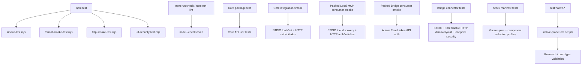

# Raya MCP — Dependencies and Test Map

**Historical audit snapshot:** 2026-11-25\
**Staging validation addendum:** 2026-11-26 — dependencies installed with `npm ci --ignore-scripts`; `npm run check` passed. See [ACCEPTANCE-RESULTS.md](../ACCEPTANCE-RESULTS.md) for scope and limitations.

## Runtime dependencies

| Package | Declared version | Main usage |
|---|---:|---|
| @ijoolaie/mcp-core | 0.1.0 workspace | MCP server/client factories and STDIO/Streamable HTTP server/client transport constructors; declares Zod peer dependency |
| @ijoolaie/local-mcp | 0.1.0 workspace | Local MCP server/runtime and filesystem, process, search, URL and document-format tools; depends on Core |
| @ijoolaie/bridge | 0.1.0 workspace | Admin Panel/tunnel lifecycle plus generic MCP connector; depends on Core client/transport APIs, not Local MCP |
| @ijoolaie/stack | 0.1.0 workspace | Full distribution meta-package; pins Core, Local MCP and Bridge and declares four install profiles |
| @modelcontextprotocol/sdk | 1.32.2 | MCP SDK runtime; owned directly by Core and also used by root integration tests |
| zod | 4.6.7 | Input schemas and validation |
| docx | ^9.14.0 | DOCX creation |
| exceljs | ^4.4.0 | XLSX read/write |
| mammoth | ^1.13.0 | DOCX text extraction |
| pdf-lib | ^1.17.1 | PDF create, inspect, merge and annotate |
| pdf-parse | ^2.4.5 | PDF text extraction |
| jszip | 3.10.2 | Direct DOCX package-part editing dependency used by `docx_replace_text` |

Package overrides pin/override uuid 11.1.1, archiver 8.0.0, unzipper 0.12.5 and minimatch 11.0.1.

## Main scripts

| Script | Declared action | Interpretation |
|---|---|---|
| start | node server.mjs | Starts MCP server using its default transport selection |
| start:http | node server.mjs --http | Starts HTTP mode |
| check | long chain of node --check | Syntax checks source, smoke tests, package tests and many .native-probe files; does not execute tests |
| verify:modular | check + package tests + `scripts/verify-modular-packages.mjs` | Enforces package dependency direction, source import boundaries, packed clean installs for all four profiles, Local MCP STDIO and Bridge connector acceptance |
| test | smoke-test.mjs, format-smoke-test.mjs, http-smoke-test.mjs, url-security-test.mjs | Four standard test programs |
| lint | npm run check | Alias for syntax check chain, not a separate lint engine |
| test:native-* | individually named native/prototype test scripts | Opt-in research/validation tests; not part of standard test script |

## Test topology

## Important boundaries

- The package check script syntax-checks many files under .native-probe; that does not make those files production runtime dependencies.
- Native test scripts are individually named and are not included in the standard npm test script.
- The presence of a test script does not establish that it passed on the current working tree. Current Core, Local MCP and Bridge extraction evidence is recorded in `PROJECT-STATUS.md`; Bridge connector tests are `npm --workspace @ijoolaie/bridge test`.
- Do not run npm install or mutate lockfiles as part of read-only diagnosis.
- The npm lint script is an alias for npm run check; do not describe it as ESLint or equivalent.
- Standard npm test has known side effects: smoke-test creates temporary fixtures and child processes; format-smoke-test calls set_config_value(search.maxDepth=8), persisting that setting to raya-config.json without restoring the previous value; http-smoke-test starts a local listener on port 18766. Doctor must not invoke it automatically.
- See [TEST-COVERAGE.md](TEST-COVERAGE.md) for the assertion inventory, native/prototype script list, exact side effects and evidence limits. See [FUNCTION-MAP.md](FUNCTION-MAP.md) for tool-to-handler and helper routing.

## Fast routing

- MCP protocol or SDK issue → `@ijoolaie/mcp-core`, `@modelcontextprotocol/sdk`, `packages/raya-mcp-core/src/index.mjs`, `packages/raya-local-mcp/src/server.mjs`, root `server.mjs` wrapper, `core-integration-smoke.mjs`, `local-mcp-http-consumer-smoke.mjs`, `bridge-consumer-smoke.mjs`, `smoke-test.mjs` / `http-smoke-test.mjs`.
- Tool schema/validation issue → zod and the matching registration module.
- DOCX issue → docx / mammoth, format-tools.mjs, format-smoke-test.mjs.
- XLSX issue → exceljs, format-tools.mjs, format-smoke-test.mjs.
- PDF issue → pdf-lib / pdf-parse, format-tools.mjs, format-smoke-test.mjs.
- URL safety issue → url-tools.mjs and url-security-test.mjs.
- Native filesystem/security issue → .native-probe docs and test-specific script, but do not infer production acceptance from prototype tests.
