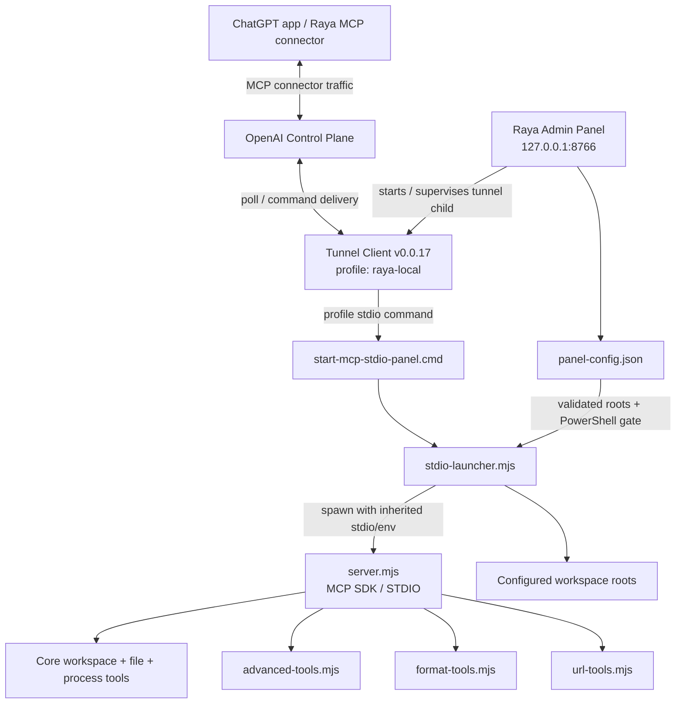
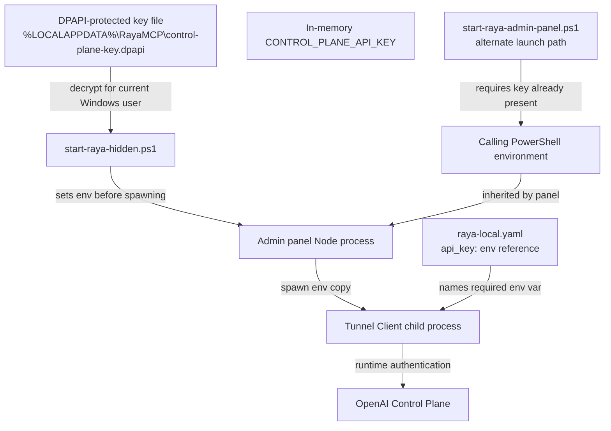
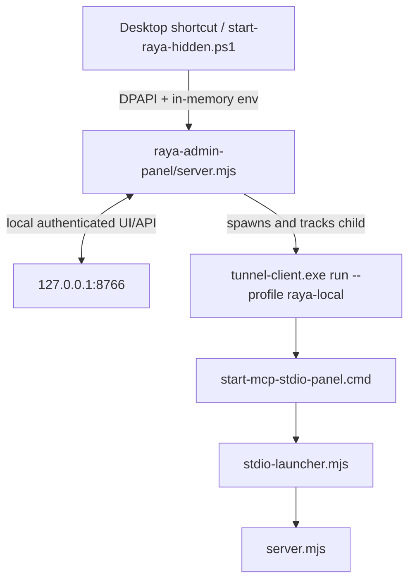
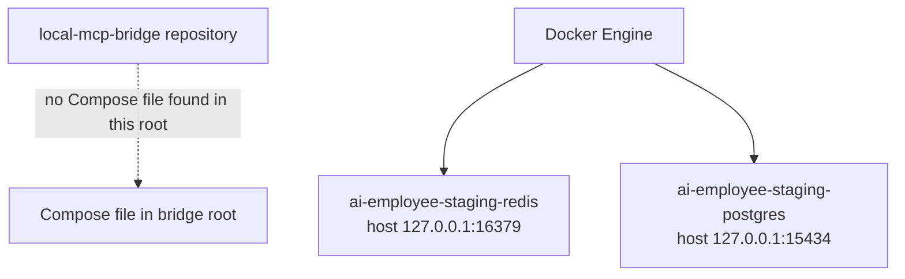
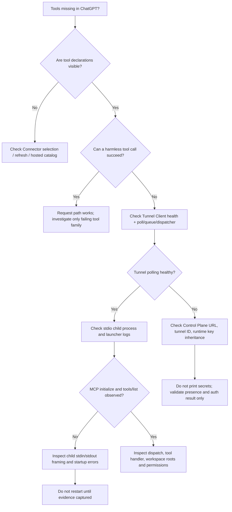
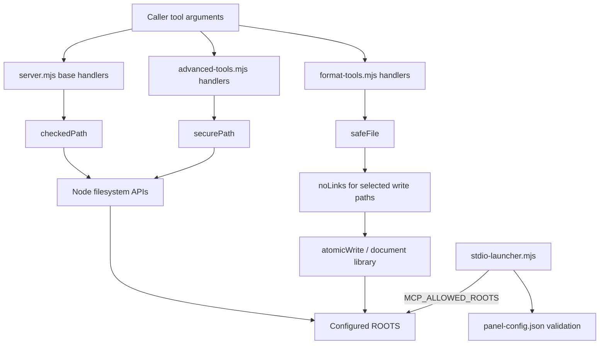

# Raya Local MCP — Runtime & Dependency Graphs

**Snapshot:** 2026-11-25\
**Repository:** `C:\Users\Ali\local-mcp-bridge`\
**Status:** Initial evidence-backed map; not a complete security or production architecture approval.

This document is the starting map for future diagnosis. It separates verified runtime paths from configuration relationships and unverified assumptions. Update it when a launcher, profile, root list, service, container, or connector configuration changes.

## 1. Runtime / request-flow graph

**Evidence and qualifications**
- The active profile previously inspected was `%APPDATA%\tunnel-client\raya-local.yaml`, with tunnel ID `tunnel_6adaf37ba87c819190a638ae8f1729f7` and stdio command `start-mcp-stdio-panel.cmd`.
- The launcher source validates `panel-config.json`, requires the bridge root, rejects invalid/nested roots, then spawns `server.mjs` with inherited stdio.
- `server.mjs` imports and registers core tools plus advanced, format, and URL tool families.
- On 2026-11-25, live ChatGPT calls to `workspace_roots` and `workspace_list` succeeded. This verifies the current request path for those two tools, not every tool.
- The Tunnel Client health observer previously showed `initialize_epoch=0` and no retained `tools/list`; that observer state was not a reliable proxy for the visible live connector catalog. Treat health, catalog visibility, and successful tool calls as separate signals.

## 2. Authentication / environment dependency graph

**Operational rules**
- The secret value must never be written into YAML, source code, logs, screenshots, or this documentation.
- The profile's `env:CONTROL_PLANE_API_KEY` is a reference, not the key itself.
- The desktop launcher decrypts the DPAPI value into process memory before launching the panel. The panel's tunnel-start path copies its process environment into the Tunnel Client child.
- The alternate `start-raya-admin-panel.ps1` path requires `CONTROL_PLANE_API_KEY` to already exist in the calling PowerShell session.
- A new/rotated key must be provisioned into the DPAPI store used by the launcher, and the processes that consume it must be relaunched/inherit the updated environment. Updating only the profile's env reference does not update the secret.
- A successful one-off command after manually loading the DPAPI key proves that key can authenticate that command; it does not prove every already-running process has inherited the same value.
- DPAPI is user/machine-context sensitive. Do not copy its encrypted blob to another Windows account or machine and assume it will decrypt.

## 3. Admin panel and MCP child process graph

The admin panel is a local management UI, not a Windows service. It only manages a tunnel process that it started itself. A tunnel already running outside its ownership is deliberately not adopted or stopped by the panel.

## 4. Docker / external services snapshot

**Observed 2026-11-25**
- `docker ps` showed `ai-employee-staging-redis` and `ai-employee-staging-postgres`; Postgres was reported healthy.
- Read-only `docker inspect` identified Postgres as Compose project `ai-employeestaging`, rooted at `C:\\Users\\Ali\\AI-Employee\\.worktrees\\Ai-employee Staging`, using `docker-compose.retention-staging.yml`. This is an AI-Employee staging service, not part of the MCP repository's own runtime.
- Redis has no Compose project/working-directory/config-file labels and uses the default `bridge` network; its owner remains unknown.
- `docker compose ps` from the bridge root failed with `no configuration file provided: not found`.
- This does **not** prove Docker is broken or that either container is a dependency of Raya MCP. The Postgres ownership is known to be AI-Employee staging; Redis remains unattributed. Neither has been proven to be required by the MCP server.
- Do not stop, recreate, prune, or modify these containers during Raya MCP diagnosis until their owning project and dependencies are established.

## 5. Current evidence ledger

| Relationship / component | State | Evidence |
|---|---|---|
| ChatGPT connector → MCP tool calls | **Verified for two read-only tools** | Live `workspace_roots` and `workspace_list` calls succeeded on 2026-11-25 |
| Control Plane → Tunnel Client | **Previously observed healthy** | Successful polling and read-only tunnel metadata lookup |
| Tunnel Client → stdio launcher | **Observed in config and process/log evidence** | Active profile and logs from 2026-11-25 |
| stdio launcher → MCP server | **Verified by source and independent MCP test** | Launcher source; independent initialize/tools/list test returned 47 tools |
| MCP server → tool families | **Verified by source** | Imports and registrations in `server.mjs` |
| DPAPI → panel → Tunnel Client key inheritance | **Verified by source design; rotation history not fully proven** | `start-raya-hidden.ps1`, panel start code, profile env reference |
| Docker containers → Raya MCP | **Unknown** | Containers visible, no Compose file in bridge root |
| Connector catalog refresh root cause | **Unknown** | Refresh restored visibility, but internal trigger was not captured |

## 6. Diagnostic decision path

## 7. Repository preservation note

At the time of this snapshot, `git status` showed numerous modified tracked files and untracked files/directories. These are pre-existing working changes and research artifacts. Do not reset, clean, overwrite, move, or delete them as part of routine diagnosis. New operational documentation should be added as new files and reviewed separately.

## 8. Documentation coverage and remaining work

The operations map has companion documents: KNOWLEDGE-INDEX.md, TOOL-CATALOG.md, FUNCTION-MAP.md, TEST-COVERAGE.md, SECURITY-BOUNDARIES.md, DIAGNOSTIC-RUNBOOK.md, REPOSITORY-INVENTORY.md and DOCTOR-DESIGN.md. This is a navigable source map, not a claim that every file in every workspace has been semantically audited.

The handler-level source inspection, document write-path review, process/search lifecycle mapping, standard-test assertion inventory, and native/prototype test classification have now been added in FUNCTION-MAP.md and TEST-COVERAGE.md. The map remains a source-level reference, not a runtime test report or security certification. Remaining validation items are deliberately separate: current test execution (which requires approval because npm test mutates raya-config.json), race/exploit testing, any runtime changes, and executable Doctor implementation. Executable Doctor implementation requires explicit approval.

## 9. Source-level runtime findings (2026-11-25)

- server.mjs creates the base MCP server, then calls registerAdvancedTools(server, { ROOTS }), registerFormatTools(server, { ROOTS }), and registerUrlTools(server). The three registration layers must be diagnosed independently.
- advanced-tools.mjs dynamically registers 24 named tools through addTool; format-tools.mjs registers 14 named tools directly. URL tools register read_url. The base layer registers its own workspace/file/check tools.
- The panel status endpoint reports whether its own process has CONTROL_PLANE_API_KEY as a boolean only, plus tunnel and health observer state. Do not query or log the key value.
- startTunnel refuses to start if the key is absent from the panel process environment or if port 8080 already has a healthy tunnel not managed by that panel. stopTunnel only stops the child process owned by that panel.
- Panel API routes are loopback/Host constrained and require Bearer authorization; browser UI uses a token-gated initial page and a strict cookie.
- MCP health observer fields must be interpreted with the observer's STDIO-probe limitation. Static tool registration and independent MCP server success do not prove live tunnel-child discovery.

## 10. Tool and filesystem trust graph

See SECURITY-BOUNDARIES.md for the full path-validation matrix and caveats. The high-level code path is:

The three path helpers are separate implementations. Their shared intent is workspace containment, but they must not be assumed to have identical edge-case behavior. The project status still marks production path-based confinement as not race-free/NOT ACCEPTED; this graph does not upgrade that status.
