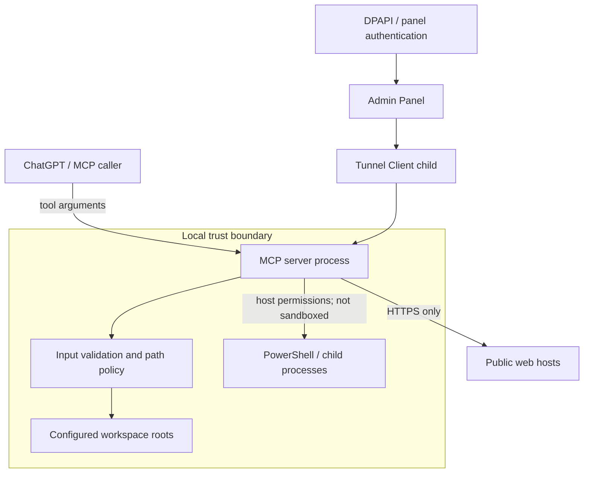

# Raya MCP — Security Boundaries and Filesystem Access Map

**Snapshot:** 2026-11-25\
**Method:** Read-only source inspection. No exploit tests, race tests, permission changes, or runtime mutations were performed.\
**Important:** This is a source-level map, not a security certification. For per-tool helper chains, write semantics and exact limits, see [FUNCTION-MAP.md](FUNCTION-MAP.md); for test scope and evidence limits, see [TEST-COVERAGE.md](TEST-COVERAGE.md).

## 1. Trust boundaries

## 2. Workspace root authority

- stdio-launcher.mjs reads raya-admin-panel/panel-config.json, requires version 1 and 1..32 roots, and validates each configured root.
- It rejects drive roots, symlink/junction roots, Windows/system and Program Files roots, duplicate/nested roots, and requires the local-mcp-bridge root.
- It passes the validated list to server.mjs through MCP_ALLOWED_ROOTS.
- server.mjs resolves MCP_ALLOWED_ROOTS into ROOTS. If MCP_ALLOWED_ROOTS is absent, it uses DEFAULT_ROOTS under USERPROFILE.
- The observed panel configuration contains 12 roots, including local-mcp-bridge and several D:Workproject roots, D:android-app, D:Raya-TLC-states-archive-20261111, and C:UsersAliDownloadsText-To-Speech-repo (1).
- Root configuration is authority, not merely a convenience list. Treat every configured root as accessible to tools subject to each handler's path checks.
- Separate user instruction applies to Text-To-Speech-repo (1): read-only access only. Do not write, overwrite, move, rename or delete anything there, regardless of the configured root allowlist.

## 3. Path-handling implementations

### server.mjs — base filesystem tools
- insideRoot uses path.resolve + path.relative lexical containment.
- checkedPath first requires lexical containment, resolves the root with realpath, walks upward to the nearest existing path using lstat, resolves that path with realpath, then appends missing suffix components and checks containment again.
- file_read/file_read_chunk use checkedPath before stat/open/read.
- file_write and file_write_chunk also check parent containment. file_write uses wx unless overwrite=true. Chunk upload uses a temporary same-directory file and fs.link to publish without replacing an existing destination.
- workspace_list and workspace_roots expose configured root metadata/entries.
- Source review did not establish race-free handle-relative access. Path validation and later filesystem operations are separate operations; do not label this implementation TOCTOU-safe.

### advanced-tools.mjs — advanced filesystem tools
- securePath performs lexical containment and canonical realpath checks, including nearest-existing-parent logic for allowed missing targets.
- noSymlinkAncestors is used by selected operations to reject symbolic-link ancestors.
- create_directory, read_multiple_files, list_directory, move_file, edit_block, search and metadata tools have their own handlers and limits; inspect the exact handler before assuming one shared policy covers all.
- Source-level path checks are not proof of race-free confinement.

### format-tools.mjs — DOCX/PDF/XLSX
- safeFile performs lexical and canonical realpath containment.
- noLinks rejects symlink components for selected write/modify paths.
- Writes use a same-directory temporary file and rename through atomicWrite.
- Read and write size limits are generally 10 MiB per document; PDF merge has separate aggregate limits.
- Formula and document replacement functions have explicit validation/confirmation parameters, but these do not replace filesystem boundary validation.

## 4. Process and shell boundary

- start_process launches an executable with argument array and a restricted inherited environment allowlist; it is not equivalent to a sandbox.
- powershell_execute runs on the Windows host with the server user's permissions when enabled.
- get_config explicitly reports shellIsSandboxed=false.
- The panel configuration currently has powershellEnabled=true; actual MCP capability is controlled by MCP_ENABLE_POWERSHELL in the MCP server process environment.
- Never claim a command is isolated merely because cwd is inside a workspace.
- Process termination tools are powerful actions and require separate approval in operational workflows.

## 5. Advanced process and search behavior

- start_process requires a configured workspace cwd, spawns with shell=false and an argument array, and inherits only safeChildEnv's allowlist plus non-secret overrides. It is still a host process under the MCP server user's permissions.
- Managed process sessions are retained in memory, capped by raya-config.json, and expose bounded stdout/stderr. A configured timeout can terminate the process tree.
- force_terminate acts on a managed session ID. kill_process separately checks PID plus expected process name and requires confirm=true; neither should be used during read-only diagnosis.
- list_processes returns a bounded process metadata view (PID/name/CPU/working set), not command lines or environment values.
- start_search is bounded by max depth, max results, a scan time budget and session retention. Content mode skips files larger than the configured per-file text limit and suppresses per-file read errors; no match does not prove content is absent from inaccessible/oversized files.

## 6. Public URL boundary

- read_url accepts HTTPS only, rejects non-standard ports and credential-bearing URLs.
- It blocks localhost/local hostnames and non-public IP ranges after DNS resolution.
- It pins the HTTPS connection to the resolved IP and revalidates redirects, with a maximum redirect count, timeout and byte cap.
- This is the public-web fetch tool; do not conflate it with local filesystem or browser access.

## 7. Known limitations and open questions

| ID | Finding | Status |
|---|---|---|
| SEC-01 | Production filesystem handlers are path-based; race-free confinement is not accepted in project status | Known limitation |
| SEC-02 | Native HANDLE-relative/broker implementations are research/prototype-only | Known boundary |
| SEC-03 | A source-level review cannot establish absence of TOCTOU races | Not proven |
| SEC-04 | Exact effective roots in a running child should be checked from safe runtime metadata, not guessed from an interactive shell | Runtime check pending |
| SEC-05 | No exploit/race test was run during this documentation pass | Not tested |
| SEC-06 | PowerShell enabled flag in panel config and MCP process capability are separate values | Verified distinction |

## 8. Evidence and confidence

- **Verified from source:** launcher root validation; MCP_ALLOWED_ROOTS handoff; three path-helper implementations; shellIsSandboxed=false; URL validation and pinned HTTPS fetch.
- **Observed in config:** 12 panel-config allowed roots; powershellEnabled=true.
- **Not established:** race-free filesystem confinement; exact runtime effective environment; whether any current issue is exploitable.
- **Do not infer:** prototype success means production migration accepted; a workspace root means every operation is safe; a path guard alone means race-free access.
